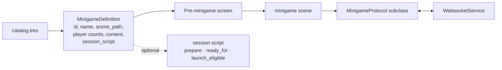
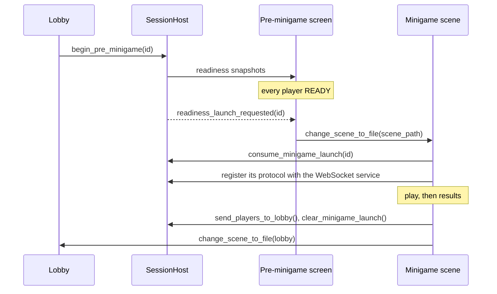

# Minigame Contract

> What a minigame must provide so the shared game can list it, prepare its players, launch it,
> route its messages and take everyone back to the lobby, without the shared code naming it.
> The one idea: **the shared code knows a minigame only through its catalog definition and its
> protocol object.**

Up: [[Play Shapes Overview]] · Down: [[004 Bubbles and Jellyfishes Design]],
[[005 Tilt Shift Design]], [[006 Flappy Race Design]] · Where in code: [[Minigame Catalog]]

## Context and constraints

- The host is the authority; a minigame's phone code sends input and choices only.
- Minigame numbers are stable identifiers, never reused.
- Listing the catalog must load no minigame scene, art or script: a definition holds paths,
  not resources ([[0024-minigame-catalog|0024]]).
- Every normal launch goes through the Pre-minigame screen
  ([[0032-mandatory-pre-minigame-screen|0032]]).

## Concepts

- **Definition**: the minigame's entry in `minigames/catalog.tres`.
- **Session script** (optional): a Node that follows the round from the Pre-minigame screen into
  play, for minigames that prepare players, such as Tilt Shift's motion calibration
  ([[0039-minigame-session-scripts|0039]]).
- **Protocol**: a `MinigameProtocol` subclass. It says which message types it `handles`, answers
  them in `handle_message`, gives a resuming phone its `snapshot_for`, and asks the service to
  send through its `send_requested` and `broadcast_requested` signals.

## How it works

The launch is a one-shot handoff: the minigame scene consumes the pending launch, which holds
the round's participants, and a second consume returns nothing.

## Extending it

The steps are in [[Minigame Catalog]] and the folder layout in [[Minigames]]. Mistakes to avoid:

- Naming a minigame in shared code instead of reading its definition.
- Forgetting the three places that still name each minigame by hand (see [[Improvements]]).
- Skipping the workshop: it is planned with the minigame
  ([[0052-a-workshop-for-every-minigame|0052]]).

## Decisions and history

[[0015-one-folder-per-minigame|0015]] one folder per minigame;
[[0024-minigame-catalog|0024]] the catalog; [[0032-mandatory-pre-minigame-screen|0032]]
the mandatory Ready screen; [[0039-minigame-session-scripts|0039]] session scripts;
[[0049-minimum-players-per-minigame|0049]] per-minigame minimum players.

## Known debt and direction

- Phone asset routes and the export policy still list each minigame by hand *(unverified
  whether a step to derive them is planned beyond the [[Roadmap]])*.
- Each minigame scene changes back to the lobby itself; the return path is repeated in three
  scenes rather than offered by the host.
