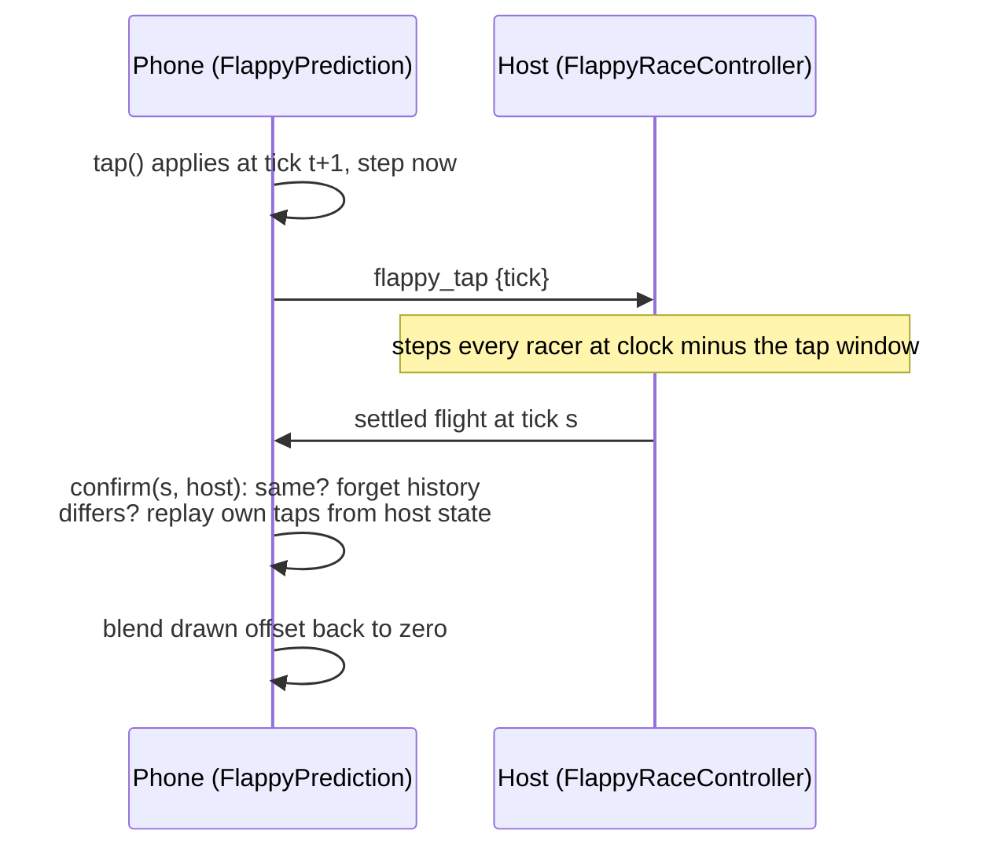

# Shared Deterministic Prediction

> How a phone shows its own character the instant the player taps, while the host stays the
> authority. The one idea: **the phone and the host run the same step, bit for bit, from the
> same taps at the same ticks**, so the host's settled state almost always agrees.

Up: [[Play Shapes Overview]] · Down: [[006 Flappy Race Design]] · Where in code:
[[006 Code Map]]

## Context and constraints

- Wi-Fi delivers a tap 30 to 100 ms late. Timed by receipt, the host's flight would disagree
  with the phone's ([[0048-predicted-input-carries-a-tick|0048]]).
- Jolt cannot run in the browser, so a predicted character cannot use the engine's physics
  ([[0047-shared-deterministic-simulation|0047]]).
- The host must never take back a hit it already counted and showed.

## Concepts

- **Shared step**: a fixed 60 Hz step written twice, GDScript and TypeScript, with the same
  arithmetic in the same order, on 64-bit floats. Durations are whole ticks.
- **Tick-stamped input**: a tap carries the tick the phone applied it at, never a wall-clock
  time.
- **Settled tick**: the host steps every predicted character one tap window behind its own
  clock (250 ms by default), so late taps still land on their tick.
- **Fixture**: committed runs with their events and a digest of every tick, reproduced by both
  languages' tests.

## How it works

On a mismatch the phone replaces its state with the host's at the settled tick, replays its own
remembered taps up to now, and keeps the difference as a drawn offset that decays, so the
character slides back instead of jumping. A replay or catch-up steps at most 600 ticks.

## Extending it

- **Any change to the step changes both languages and regenerates the fixture in the same
  commit** (the command is in [[Verification]]).
- Keep state in plain `float` fields in GDScript; `Vector2` and `Rect2` hold 32-bit values.
- Use only `+ - * /`, `min` and `max`. Geometry sent to the phone is snapped to 1/64 m so JSON
  carries it exactly.
- Jolt stays the default for any character the phone does not predict.

## Decisions and history

[[0047-shared-deterministic-simulation|0047]] the shared step;
[[0048-predicted-input-carries-a-tick|0048]] tick-stamped taps settled one window behind.
Replaying late taps over host history was rejected because it could undo a counted hit.

## Known debt and direction

Flappy Race is the only user so far. A second predicted minigame would show which parts of
`FlappyPrediction` belong in shared code *(unverified: no such minigame is planned yet)*.
