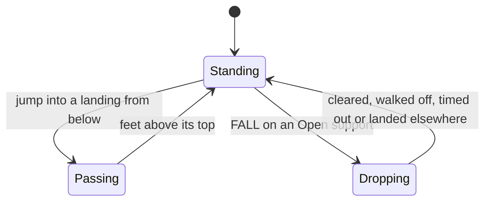

# Lobby Platform Motor

> How a Cubio in the plaza runs, jumps through landings from below and drops through them on
> FALL, on Jolt, while the controls still feel 2D. The one idea: **Jolt has no one-way shapes,
> so the motor makes landings one-way per body with collision exceptions.**

Up: [[Play Shapes Overview]] · Down: [[Lobby Journey]] · Where in code:
[[Platform Movement Parts]], [[Platform Controller]]

## Context and constraints

- Every gameplay scene runs on Jolt with bodies locked to one plane; the lobby was the last 2D
  code ([[0042-plaza-lobby-jolt-plane|0042]]).
- Phone controls and their host rules had to stay: one-way landings, FALL through Open landings
  only, player bounce, the 350 ms input lease and the fall-reset respawn.
- Ten characters must stay cheap: about 0.14 ms a physics step on the development PC.

## Concepts

- **Body**: a `CharacterBody3D` whose depth `PlaneLock3D` locks at zero; its `Cubio3D` rides as
  a child, nothing is mirrored.
- **Landing**: a `PlatformSurface` box built per `PlazaLanding` marker, one-way, with a Drop
  Rule: Open (FALL may pass) or Closed (the ground).
- **Exception set**: the surfaces this body currently ignores.

## How it works

Each physics step, before `move_and_slide`, the motor sweeps the body's bounds along its
velocity. Every one-way surface whose top is above the feet and that the sweep meets is added
to the body's exceptions; every other excepted surface is released. So a body passes up and
sideways through a landing but stands on it once its feet are above the top.

FALL adds the one Open support underneath to the exceptions until the body clears it by
`drop_clearance`, walks off its edge, lands elsewhere or `drop_timeout_seconds` pass. Landing
on another character from a fast enough fall bounces it. Falling below `fall_reset_y` clears
input and requests a respawn.

## Extending it

Any minigame played on one plane can reuse the motor and its landings: add `PlatformSurface`
boxes, which join the `platform_surfaces` group themselves, and a body with the motor. Setup is in [[Platform Controller]]. A
character the phone predicts does not use it; see [[Shared Deterministic Prediction]].

## Decisions and history

[[0033-plaza-lobby-plane-simulation|0033]] simulated the lobby on a hidden 2D plane and
mirrored it into 3D; [[0042-plaza-lobby-jolt-plane|0042]] replaced it with Jolt and this
motor.

## Known debt and direction

Cubio has no jump or fall clip; in the air the lobby keeps whichever clip the motor reports.
