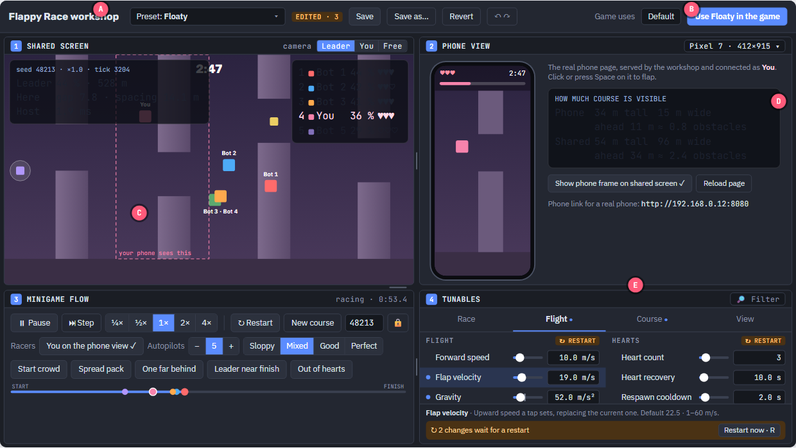
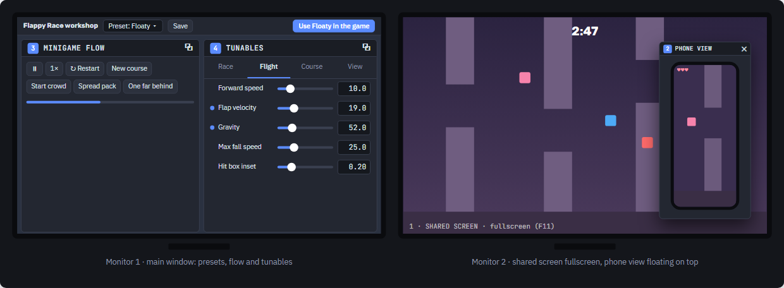

# Minigame workshops

Every minigame has a workshop: a slice of the game where the designer sees, plays and tunes it
on the PC. The game itself runs from scripts with no scene a person can look at, so the
workshop is where game feel is decided. This document is the design every workshop follows;
each minigame adapts only the parts listed under [What each minigame supplies](#what-each-minigame-supplies).
Why: [decision 0052](../decisions/0052-a-workshop-for-every-minigame.md).

## Same as the real game

- A workshop runs the minigame's real controller, protocol, presentation, phone page and tuning.
  What the designer feels in the workshop is what players feel in a real game; only the
  placeholder visuals may differ while final art is missing.
- Additions sit around the game and never change how it settles input: autopilot players fed
  through the same input path as phones ([0008](../decisions/0008-bots.md)), quick setups,
  readouts.
- Joining by QR, the Playground lobby, minigame choice and the Pre-minigame screen are skipped.

## Starting a workshop

- A workshop is a scene started on its own (F6 in the editor, or from the F12 launcher), not a
  stop inside the full game.
- It goes through the game's boot, which runs the essential steps and only the optional steps
  the workshop asks for, such as the HTTP and WebSocket servers bound to this PC, with no
  certificate, for its phone view.
- Workshops save into the project's files, so they are left out of the exported game.

## The window

- A top bar holds the preset being edited, its count of unsaved edits, Save, Save as, Revert,
  Undo and Redo, then the preset the game uses with a button to use the current one instead.
  There is no file menu.
- Four named panels sit below it: 1 Shared screen (top left), 2 Phone view (top right),
  3 Minigame flow (bottom left) and 4 Tunables (bottom right). Grips between them resize them.
- Any panel can pop out into its own window, by a button in its title bar, and be moved to any
  monitor, maximized or made fullscreen. Closing that window docks the panel again.
- Which panels are out, their monitors, positions and sizes are remembered. Reset layout brings
  every panel back into one window.

## The panels

- **Shared screen:** the minigame's real shared-screen presentation, with a camera choice in
  its title bar and readouts drawn over it; Tab hides them. Popped out and fullscreen, it shows
  exactly what players see.
- **Phone view:** the real phone page, served by the workshop and shown in a phone frame sized
  by a device picker, connected as the designer's own player. It stays docked until the web
  view add-on can draw in a popped-out window
  ([0054](../decisions/0054-workshop-phone-view-in-godot-wry.md)).
- **Minigame flow:** restart, the seed where the minigame has one, the players taking part,
  autopilots and their skill, and quick setups that restart into a named situation. The game
  always runs at real time: a phone predicts on its own clock, so there is no pause or speed.
- **Tunables:** one tab per tuning Resource, generated from it and grouped by its export
  groups. Each value is one row: an edited dot, its label, a slider with the Default preset's
  value marked, and the number with its unit. A curve over the course is two rows, its start
  and its finish. The selected row shows its help, default and range.
- A filter finds a value by name. Edits waiting for a restart and validation errors sit at the
  bottom of the panel.

## Presets

- A preset is one file holding every part of a minigame's tuning, kept in the minigame's
  `tuning/` folder. The list offers duplicate, rename, delete and copying one tab from another
  preset.
- Save writes the current preset; Save as makes a new one and edits it. Saving over Default
  asks a second time. A preset with validation errors cannot be saved or used.
- Using a preset in the game writes only that minigame's entry in `Tuning/Active Presets.tres`,
  after a confirmation listing every value that differs from the preset in use. The designer
  commits the change.

## Live and restart values

- Each tuning Resource declares which of its groups apply live. Everything else waits for a
  restart, marked in the Tunables panel and applied with R or the restart button, never on its
  own.
- A value the phone receives when the game starts, or that the phone's prediction depends on,
  waits for a restart, so phone and host never disagree.

## What each minigame supplies

- Its scene and the optional boot steps it needs.
- Its Minigame flow controls: the players and autopilots it supports, its quick setups and
  any way to place players.
- Its readouts and its shared-screen camera choices.
- Which tuning groups apply live.
- Its phone orientation and the device sizes worth checking.

Planning a new minigame includes planning its workshop, recorded in a Workshop section of its
design document.

## Flappy Race

The first workshop. Its minigame-specific parts are in
[the Flappy Race design](Minigames/006/006%20-%20Flappy%20Race.md#workshop).
