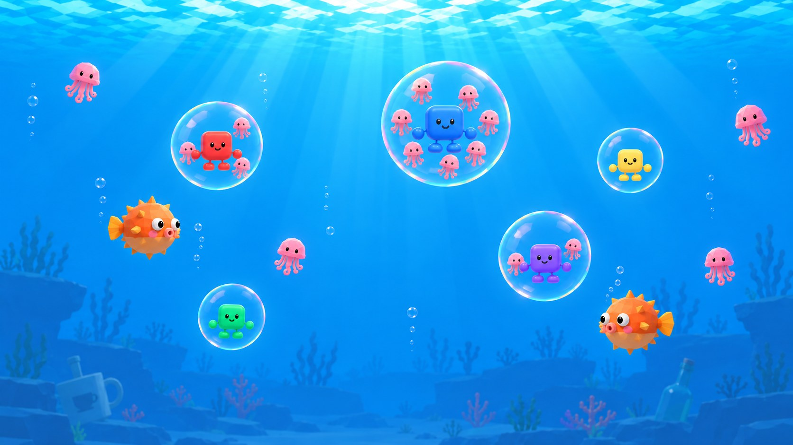
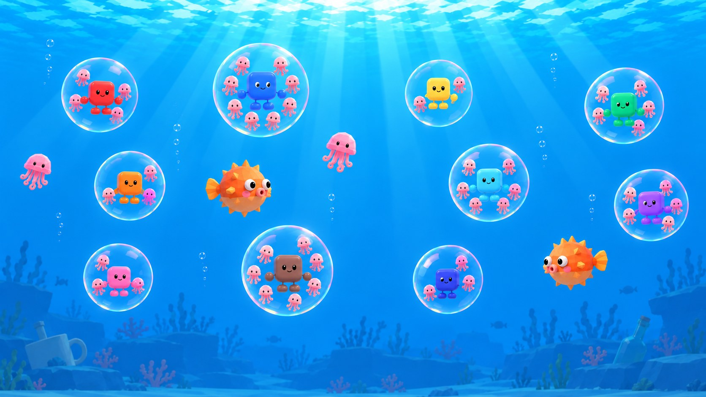

# 004 scene composition

How the shared-screen scene of [[004 - Bubbles and jellyfishes 3D]] is put together. Model sources and their changes are in [[004 - Asset sources]].

## Intended player experience

A bright, clear underwater arena where colourful bubbles, pink jellyfishes and orange pufferfishes read instantly from the couch. The water feels alive through light and motion, not through clutter. It belongs to the same toy-like low-poly world as the 3D lobby.

## Approved composition reference

The two mockups are approved for layout, readability and mood. Their exact object sizes, colours and decoration are illustrative: final sizes come from tuning, and the models come from the asset sources.

## Gameplay space and camera

- All play happens on one vertical plane at depth zero: bubbles move in X and Y only.
- The playable plane is 19.2 × 10.8 world units (one unit is 100 pixels of 002's arena), centred on the origin, with invisible walls at its edges that affect bubbles only.
- The camera is fixed, near-frontal, with a narrow perspective (about 30° field of view) and a level horizon, framing the playable plane edge to edge at 16:9.
- Nothing scenic sits on or in front of the gameplay plane. All scenery is behind it.
- Timer, countdown, nameplates and results are screen UI, not scene objects.

## Layers, back to front

| Layer | Content | Notes |
| --- | --- | --- |
| Water backdrop | Vertical gradient from bright cyan at the top to deep blue at the bottom; a rippling, brighter surface band across the top | Shader on a large back plane or the environment background |
| Far seabed | A low, faceted ground strip across the bottom of the frame, rocks, the stacked reef ledges at the left and right sides | Heavily hazed toward the water colour |
| Reef dressing | Branch coral (pink, orange, purple) and kelp clusters, grouped near the lower left and lower right | Kelp sways with a vertex shader |
| Landmarks | One oversized white mug tilted on the seabed at the far left, one large green bottle on its side at the far right | Small and pale in frame, never brighter than the play objects |
| Light | God-ray shafts fanning down from the top centre, slowly drifting; caustic shimmer on the seabed and props | Additive, low intensity behind the play plane |
| Ambient motion | Small rising air bubbles in a few columns | Behind the play plane |
| Gameplay plane | Player bubbles with Squircles and caught jellyfishes, free jellyfishes, pufferfishes, pop droplets, warning bubbles | The only bright, saturated, high-contrast layer |

## Asset placement and repetition

| Scene role | Asset | Placement / scale | Repetition | Gameplay relevance |
| --- | --- | --- | --- | --- |
| Player bubble | Bubble shell shader | Gameplay plane; radius from tuning | One per player, up to 10 | Its radius is its collider |
| Character | 3D Squircle | Centred in its bubble, about half the bubble diameter tall | One per bubble | Identifies the player |
| Jellyfish | Adapted jellyfish model | Gameplay plane; free ones about 3% of screen width, caught ones smaller, orbiting inside the bubble | Free population plus the visual cap per bubble | Collectible |
| Pufferfish | Adapted pufferfish model | Gameplay plane; about 6–7% of screen width | A few at once | Hazard |
| Branch coral | Two bare-tree models, recoloured | Far back, lower corners | 4–8 | None |
| Kelp | Two grass-cluster models, recoloured, stretched tall | Far back, lower corners and between rocks | 4–8 | None |
| Rocks | Three rock models, recoloured blue-grey | Far back along the seabed; stacked ledges at the sides | 3–5 plus 2 ledges | None |
| Sunken mug | Mug model, scaled up | Far left, tilted, partly in the seabed | 1 | None |
| Sunken bottle | Bottle model, scaled up | Far right, on its side | 1 | None |

## Readability and priorities

- The centre and upper two thirds of the frame stay open water.
- Background colours stay desaturated and hazed so bubbles, jellyfishes and pufferfishes always win on contrast.
- Pufferfishes stay distinguishable from jellyfishes by silhouette alone: spiky round body against dome and tentacles.
- The bubble must not hide its character: the shell stays clear in its centre, with colour only at the rim.
- With ten players at maximum size the scene must still read: verify with a ten-player state.

The landmarks, kelp sway and caustics are optional polish if the Compatibility renderer budget is tight; the water gradient, god rays and the gameplay objects are essential.

## Renderer constraints

The project renders with GL Compatibility. Volumetric fog, SSR, SSAO and SDFGI are not available, so god rays are drawn as animated additive geometry, caustics as an animated shader pattern, and haze as depth fog or shader tinting. Transparent bubbles are sorted so the character and caught jellyfishes stay visible inside them.

## Reuse and variants

The water backdrop and lighting form a reusable underwater environment. Library props are copied once into the project and recoloured with material overrides in the scene; their copied sources stay unchanged. The jellyfish and pufferfish are new project variants built from library parts.

## Human review

The owner judges the result in the running game, side by side with 002: readability at couch distance with 5 and 10 players, the underwater mood, the bubble look, character visibility inside the bubble, pufferfish and jellyfish appeal, and frame rate. Automated checks cannot approve these.
