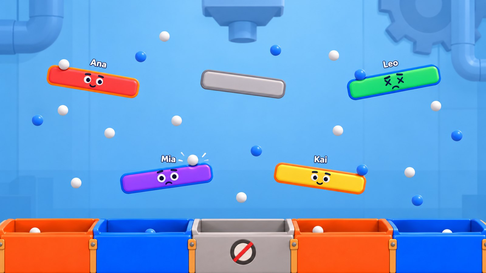
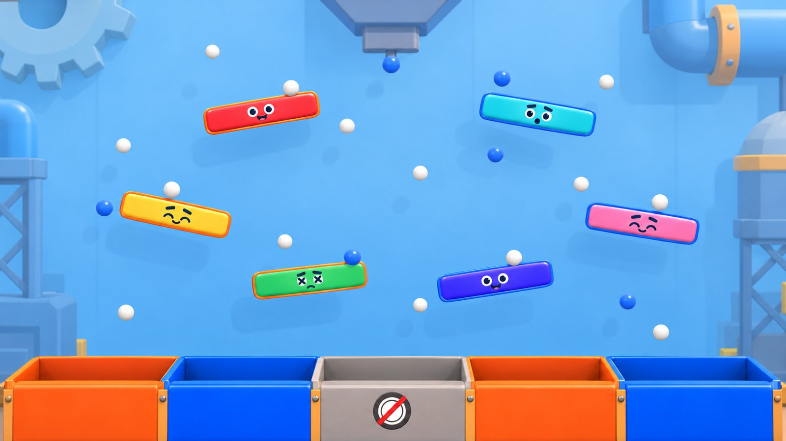

# 005 scene composition

How the shared-screen scene of [[005 - Tilt Shift 3D]] is put together. Model sources and their changes are in [[005 - Asset sources]].

## Intended player experience

A bright, clean toy-factory arena where every player sees themselves as a paddle: their colour, their face, their team outline. Balls and bins read instantly from the couch. The faces add humour and life without ever hiding the play.

## Approved composition reference

The two mockups are approved for layout, readability and mood, with two owner changes: the wall is a warm cream, not sky blue, and there is no hopper at the top. Their paddle sizes, colours, props and decoration are illustrative; final sizes come from tuning and the workshop.

Reference sheets: [shape paddle](references/shape-paddle.jpg), [bin](references/basket-bin.jpg), [factory props](references/factory-props.jpg).

## Gameplay space and camera

- All play happens on one vertical plane at depth zero: balls fall and roll in X and Y; paddles turn about the depth axis.
- The arena is 19.2 × 10.8 world units, centred on the origin, and fills the frame edge to edge at 16:9. Invisible walls sit at its left and right edges.
- The floor and the bin mouths are 0.4925 arena widths below the top; the 0.07-width bin band below them shows the bins' front panels down to the bottom edge.
- The camera is fixed, near-frontal, with a narrow perspective (about 30° field of view) and a level horizon.
- Nothing scenic sits on or in front of the gameplay plane, except the bins' front panels, which hide balls after they cross a mouth.
- Timer, round, scores, countdown, names, participant panel and results are screen UI.

## Layers, back to front

| Layer | Content | Notes |
| --- | --- | --- |
| Factory wall | Warm cream wall with a soft vertical gradient, slightly lighter at the top | Large back plane with a simple gradient material |
| Factory props | 3–5 oversized pipes, a cog, a scaffold or a tank in the upper corners and side margins | Pale teal, sky blue and warm grey, low contrast against the cream |
| Bin backs | The inner back walls and floors of the bins | Behind the plane |
| Gameplay plane | Shape paddles, the neutral paddle, balls, catch flashes | The only bright, saturated, high-contrast layer |
| Bin fronts | The bins' front panels and rims | In front of the plane, below the mouths only |

## Asset placement and repetition

| Scene role | Asset | Placement / scale | Repetition | Gameplay relevance |
| --- | --- | --- | --- | --- |
| Player paddle | Shape paddle (generated) | Layout anchors; length from layout, thickness 0.04 widths | 4–6 per round | Collider; turns with the player's angle |
| Neutral paddle | Shape paddle, grey, no face | Layout A anchor | 1 in layout A | Collider; automatic rotation |
| Face | Shape face component | Centre of each player paddle's front | One per player paddle | None |
| Name | Screen-follow label | Above each player paddle, first 5 s of each round | One per player paddle | None |
| Ball | Low-poly sphere | Spawned above the visible top | Up to the round's budget | Collider |
| Bin | Adapted crate, three-part width | One per scoring opening, mouth on the opening | 3–5 per preset | Mouth equals the scoring opening |
| Trash emblem | 2D decal | Centre of the trash bin's front panel | One per trash opening | None |
| Factory props | Six KayKit pieces, recoloured | Upper corners and side margins, well behind the plane | 3–5 placed | None |

The cream gap ring and team outline sit just behind each paddle body, visible as rings around its front silhouette, as in the paddle reference sheet.

## Readability and priorities

- Paddles win on colour and contrast; the wall and props stay pale and quiet.
- The upper half of the frame between paddles stays open so falling balls are easy to follow.
- Team identity reads from the outline and the bins without relying on the body colour.
- The face must be readable at couch distance at the default thickness; the dizzy and startled faces must read as different from the default at a glance.
- Names never overlap the HUD; when two paddles' names would overlap, they may stack.
- Verify with layout A at 4 players and layout B at 6 players, and with every player colour on both teams.

The factory props are optional polish if the Compatibility renderer budget is tight; the wall, paddles, faces, balls and bins are essential.

## Renderer constraints

The project renders with GL Compatibility. Faces are flat textured parts on a quad or layered quads in front of the paddle, unlit or lightly lit so their navy and white stay crisp. The outline and gap are geometry, not a post-process. No transparency is needed besides the face parts' alpha edges and the name fade.

## Reuse and variants

The paddle mesh builder and the face component are reusable components. The crate is one adapted model in three parts, tinted per team in the scene. Library props are copied once and recoloured with material overrides; their copied sources stay unchanged.

## Human review

The owner judges the result in the running game: readability at couch distance with 4 and 6 players, the paddle look and outline, the faces and their timing, the name fade, the cream factory mood, and frame rate. Automated checks cannot approve these.
