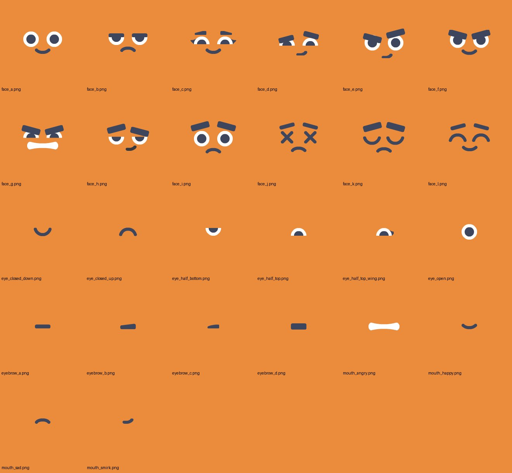

## Player facing name

Tilt Shift 3D

## Overview

Minigame 005 is Tilt Shift in the 3D low-poly world, replacing the retired 2D minigame 003. Two equal teams guide falling balls into their bins by tilting their phones like balancing beams. One playthrough is a multi-round shift.

Each Shape Character becomes the paddle it controls: the paddle is the player's own colour, carries the player's face at its centre and reacts with expressions. This "shape transformation" idea may later reach other minigames, so its pieces are built to be reused.

## Identity

- Number 005, catalog ID `tilt_shift_3d`, display name "Tilt Shift 3D", listed after 004 in `minigames/catalog.tres`.
- Code in `minigames/005_3d_tilt_shift/`, main scene `3d_tilt_shift.tscn`, phone code in `web/src/005_3d_tilt_shift/`, runtime art in `assets/runtime/minigames/tilt_shift_3d/`.
- Pieces useful beyond this minigame are reusable components outside the minigame folder. See [Reusable components](#reusable-components).

## Preparation and control

Every normal launch first shows the shared Pre-minigame screen. All players hold their phones in landscape, unlock rotation if needed, enable motion, set neutral and press READY. Portrait blocks READY; returning to portrait while waiting clears it. This initial screen is separate from the participant panels inside gameplay. Debug review remains an exception.

The starting roster is exactly 2, 4, 6, 8 or 10 players. The host selects participants for each round. A participant panel appears in round one when some players sit out, and in later rounds when the participant set changes. It shows names, player-colored paddle chips with faces and readiness grouped by team. Only selected players use READY. If the panel is skipped, READY is skipped too.

Phones enable motion and choose a comfortable neutral before or between rounds. Fresh usable calibration and landscape are required for READY; recalibration clears READY. The local host can force the round, and a 60-second panel timeout starts it regardless of connectivity. Disconnects never restart this timer. A centered 3, 2, 1 countdown and short START fade precede the full active scoring window and ball delivery.

Calibration is locked during active play. Reconnect keeps the same neutral, team and assignments. Missing input holds the last accepted angle without pausing, transferring ownership or inventing turns made during a connection gap.

## Factory shift

The host randomly forms equal Orange and Blue teams, fixed for the shift. There are two Orange, two Blue and one grey automatic paddle in layout A, and three per team in layout B. The default four rounds alternate A, B, A, B. Anchors and team colors stay fixed within each layout; dimensions are independently tunable. The neutral paddle starts at zero and rotates continuously only during active play, reversing direction at its next appearance in the same shift.

Selection favors players who have not played that layout, then those with fewer total rounds, with random ties. In a ten-player shift, round two selects the six spectators from round one. Everyone plays twice, and one player per team plays only B. Smaller rosters control several paddles together; larger shares rotate fairly and same-owner neighbors are minimized. Spectators keep their team.

Balls collide with one another and with the host's rotating paddles. A team basket adds one point to its team for a white ball and subtracts one point (clamped at zero) for a dark blue ball, regardless of who touched the ball. Trash discards it. Every ball resolves at most once. Basket presets pair team openings by reflection.

The round deadline stops scoring immediately and clears unresolved balls before the next round. Team totals accumulate; the highest shift total wins, and equal totals draw. Balls enter wholly above the fitted visible viewport. Delivery ends before the scoring deadline while preserving the configured budget and empty curve intervals. Results stay on the host until Return to lobby.

## Simulation and world scale

The host simulates 005 with Godot's 3D physics (Jolt), as 004 does ([decision 0034](../../../decisions/0034-bubbles-3d-jolt-plane.md)). Balls, paddles, walls and floor segments live on one vertical plane at depth zero; every body's depth translation is locked, balls rotate only about the depth axis and paddles turn only about it.

One world unit equals 100 pixels of a 1920 × 1080 frame. One arena width is 19.2 units; the arena is 19.2 × 10.8 units, centred on the origin, and fills the frame edge to edge at 16:9. Distances in tuning are measured in arena widths and multiplied by 19.2 in the arena.

The floor and the bin mouths sit at 0.4925 widths below the arena top so a bin band of 0.07 widths shows below them. The owner spaces the layouts in the workshop.

Balls enter wholly above the visible top. Invisible walls stay at the arena's left and right edges.

## Shape paddles

- Shape: a rounded-rectangle bar generated in code from length, thickness, depth and corner radius. The corner radius stays constant when the length changes, so the ends never stretch. No library model is used ([[005 - Asset sources]]).
- Starting sizes: player paddles have lengths of 0.20 widths in layout A and 0.18 widths in layout B at a thickness of 0.04 widths; the neutral paddle is 0.20 × 0.04. Corner radius 0.35 × thickness, depth equal to thickness.
- Colour: the body uses the player's selected Cubio colour from `characters/character_selection.gd`.
- Outline: a cream gap ring (about `#FFF3DC`, 6% of thickness) around the front silhouette, then the team outline (9% of thickness): orange `#FD8702` or blue `#0144F2`. The gap keeps the outline readable when the body colour equals the team colour.
- Neutral paddle: grey body `#A0A0A0`, darker grey outline `#707070`, no gap ring, no face.
- Face: centred on the front, 0.72 × thickness tall, scaled only by thickness, never stretched by length. The back of the paddle is plain.
- Collider: a convex shape matching the visible rounded profile, built from the same parameters as the mesh, never from node scale. Its depth exceeds the ball diameter.
- A player who controls several paddles shows the same colour, face and name on each.

## Face system

A new reusable face component composes faces from separate parts: two eyes, two eyebrows and a mouth, with mirroring for left and right. Its sources are the owner's 2D assets in `art/shape_characters_face_system_assets/`, prepared as high-resolution parts plus a preset manifest ([[005 - Asset sources]]).

The twelve reference faces, named for their emoji counterparts such as `face_slightly_smiling`, are presets that reproduce those images exactly. A missing X-eye part is cut from `face_dizzy`. Blinking swaps the eyes to `eye_closed_down` for 0.12 s every 2.4–5.6 s, as the 3D Cubio does; there is no blink while the eyes show X or are already closed.

### Expressions in 005

| Moment | Face | Rule |
| --- | --- | --- |
| Default during play | `face_slightly_smiling` | With natural blinks |
| Turning too fast | `face_dizzy` | While the paddle's applied angular speed stays at or above 150°/s for at least 0.15 s, and for 0.8 s after it drops below |
| Ball hit | `face_worried` (startled) | On each new ball contact whose closing speed is at least 0.05 widths/s: 0.35 s, plus a 12% squash of the paddle along its thickness that springs back over 0.25 s. Only the paddle that was hit reacts |
| Countdown | `face_scheming` (determined) | During 3, 2, 1 and START |
| Round end | `face_mischievous` / `face_disappointed` / `face_slightly_smiling` | Leading team confident, the other team sad, `face_slightly_smiling` for both when tied, until the next round is prepared |
| Shift results | `face_mischievous` / `face_disappointed` / `face_slightly_smiling` | Winning team confident, losing team sad, draw `face_slightly_smiling`, until Return to lobby |

During play, dizzy wins over startled, and startled wins over the default. The face never changes physics. All thresholds and durations are tunable.

## Names

Each player's name shows above every paddle that player controls when active play starts in each round, stays for 5 seconds, then fades out over 0.6 seconds. It follows the paddle's centre, stays upright while the paddle turns, and uses 004's screen-follow label. The neutral paddle has no name.

## Shared-screen presentation

See [[005 - Scene composition]] for the layout and [[005 - Asset sources]] for every model. The approved composition references are [layout A](references/mockup-layout-a.jpg) and [layout B](references/mockup-layout-b.jpg); the wall is cream rather than blue and there is no hopper, by owner decision.

- Camera: fixed, near-frontal perspective with a narrow field of view (about 30°), framing the 19.2 × 10.8 arena edge to edge at 16:9.
- Bins: one adapted crate model per opening, orange `#FD5D14`, blue `#0055FA` or trash grey `#AC9992`, with the trash emblem on the grey bin. Their mouths match the scoring openings exactly.
- Balls: low-poly spheres, warm white `#F4E6AD` and the tunable negative colour (default `#176DD1`).
- HUD, drawn over the wall: team scores in team colours in the top corners, the round and remaining seconds at the top centre, the centred countdown and START, and the round-end cutoff cue.
- Catch flashes and round-end clearing.

## Phone controls

Landscape orientation, motion permission, neutral calibration, READY, locked calibration during play, held last angle on missing input and bounded message traffic rules.

## Phone presentation

During play the phone renders the player's own paddle in real-time 3D with three.js, reusing 004's phone viewport module: the player's colour with the gap ring, team outline and face. It turns with the host's applied angle for that paddle.

- The face shows the expression the host shows on that player's paddles, sent by the host whenever it changes. Blinking runs locally.
- The mesh is built in the browser from the same parameters as the host's, and the face from the same part images and preset manifest, served by the host over HTTP, including in the Windows export.
- Background: the same cream wall gradient as the shared screen.
- Spectators see their own paddle resting level, blinking, under the team waiting message.
- Calibration, readiness and results screens.
- Without WebGL, a readable 2D drawing of the paddle and face replaces the 3D view.

## Participant panel

When the participant panel opens, each selected player appears as a small 2D chip shaped like their paddle: their colour, the gap ring, their team outline and their `face_slightly_smiling`, grouped by team with readiness.

## Pre-minigame booklet

- Title: "Tilt Shift 3D".
- Preview image: `assets/runtime/minigames/tilt_shift_3d/tilt_shift_3d_preview.png`, a 1920 × 1080 capture of the 3D round with four players.

## Results

Results stay on the host until Return to lobby. The paddles show the shift-result faces behind the results display.

## Lobby and debug flow

005 appears in the lobby's minigame dropdown beside 004 and starts through the Pre-minigame screen like every normal launch. Return to lobby keeps registered players. The F12 debug launcher offers a simulated 005 review that skips the Pre-minigame screen without granting real launch eligibility.

## Workshop

005 has its own editor workshop tab. Paddles and baskets are placed on the flat 2D canvas, which matches the single gameplay plane. It edits 005's layouts, baskets, physics and presentation Resources. Its gameplay preview launches the real 3D scene.

- Paddle length and thickness per layout, for player and automatic paddles, edit in the workshop; the canvas draws rounded paddles at their true thickness.
- Swept circles and clearance guides account for the paddle thickness.
- The Tunables tab exposes every value listed under [Designer-tunable values](#designer-tunable-values).

## Audio and feedback

Audio is deferred to the separate factory audio work.

## Reusable components

Built outside `minigames/005_3d_tilt_shift/`:

- A shape face component for Godot that composes parts, plays presets, blinks and accepts expressions with a duration and priority. It renders in 3D on a paddle and in 2D in UI.
- The same face for the phone, as a three.js module.
- A rounded-bar mesh and matching convex collider builder, in Godot and in three.js, driven by length, thickness, depth and corner radius.
- 004's plane-locked body helpers, screen-follow label and phone viewport module, reused rather than copied.

## Designer-tunable values

Distances are in arena widths unless marked.

* Round count and duration, layouts, basket presets, ball counts and curves, physics materials and limits, motion gain and preparation
* Paddle thickness per layout (start 0.04), corner radius ratio (0.35), depth ratio (1.0)
* Gap ring and outline widths (6% and 9% of thickness), their colours, the neutral paddle colours
* Face height ratio (0.72)
* Bin band height (0.07); bin and ball colours
* Name duration (5 s) and fade (0.6 s)
* Blink interval and duration
* Dizzy threshold (150°/s), its onset (0.15 s) and hold (0.8 s)
* Startled minimum closing speed (0.05 widths/s), duration (0.35 s), squash amount (12%) and recovery (0.25 s)
* The face preset used for each moment in [Expressions in 005](#expressions-in-005)
* Wall gradient colours and factory prop colours

## Answered decisions

Confirmed by the project owner on 2026-10-18:

* 005 is the 3D rebuild of Tilt Shift; 003 was retired after 005 was built.
* Mechanics, rules, phone controls and feel carry over from the original design.
* Players become their paddles: body in their colour, face at the centre, thin team outline; levers, stations and side structures are removed.
* Paddles are thicker so the face fits, and the collider grows with them and matches the rounded shape.
* The outline keeps a cream gap ring so same-colour bodies stay readable.
* The automatic paddle is plain grey with no face.
* Names show for 5 s at the start of every round and fade out.
* A new part-composed face system is built from the supplied assets, used by 005's paddles and phone only for now.
* Expressions: dizzy `face_dizzy` for fast turns, startled `face_worried` for hits, `face_scheming` for the countdown, `face_mischievous` and `face_disappointed` for results.
* Host physics is Jolt on a locked plane.
* The phone shows the player's own 3D paddle.
* The setting is a quiet toy factory with a cream wall and no hopper.
* The arena fills the full width with the floor raised; layouts are re-spaced.
* The paddle is generated in code; the bins adapt KayKit `crate`; six KayKit factory props are recoloured in the scene.
* The face parts are vectorized and exported at high resolution before the build.
* No audio yet.
* The workshop uses its 2D canvas and a 3D preview.
* The participant panel shows mini paddle chips with faces.
* The booklet uses the new title and a preview image in 005's runtime folder; F12 offers a 005 review.

## Deferred decisions

* Final numeric tuning and layout spacing, after human play.
* A 3D preview screenshot for the Pre-minigame screen.
* More expressions and moments, such as reactions to team scores or negative balls.
* Using the face system on the 3D Cubio in the lobby, 004 or other minigames.
* Audio.

## Validation needs

* Deterministic automated coverage: rules, allocation, delivery, preparation, flow, journeys, negative balls, presets, workshop and preview.
* Physics checks on the plane: locks, rounded-collider contacts, rate-bounded rotation, catches at the raised floor and the cutoff.
* Face checks: presets match the reference images, expression priorities and timings, blinking, and that faces never touch physics.
* Browser tests for the 3D phone paddle, host-driven expressions, spectators, reconnect snapshots and the no-WebGL fallback.
* Performance with ten players and the round's full ball budget, on the host and on a phone.
* Physical-phone validation on the iPhone Safari and Android Chrome pair: rendering, frame rate and motion responsiveness.
* Human play approval of feel, readability at couch distance, the paddle look and the expressions.
* Exported-build verification of 005, including the phone's face and paddle assets.
