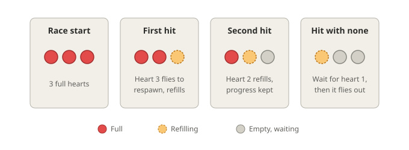
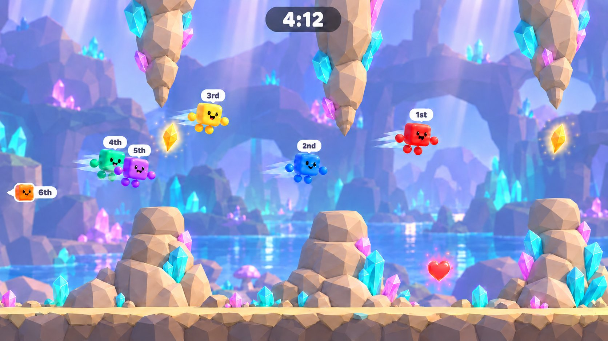
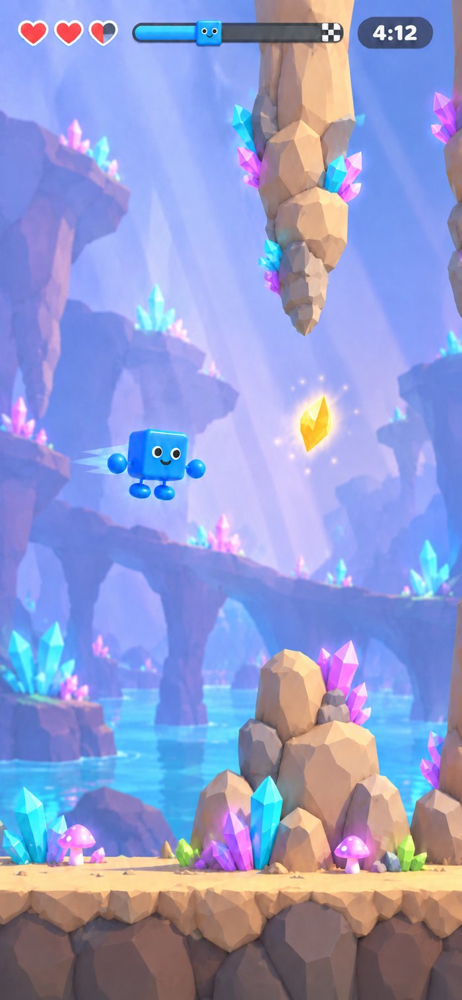
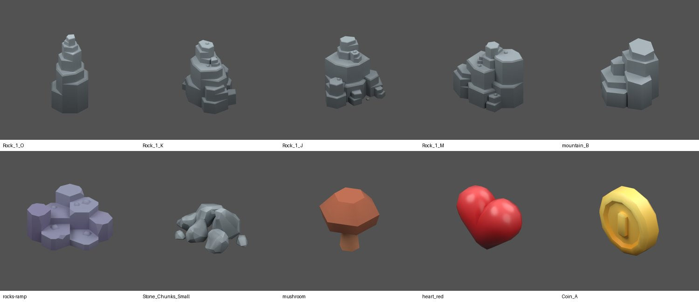

## Player facing name

Flappy Race

## Overview

Minigame 006 is a race from a start line to a finish line through a procedurally generated crystal cave. Each player taps their phone to make their winged Cubio flap, as in the original Flappy Bird, and dodges obstacles to reach the finish first.

It is the first minigame played mainly on the phone. Each phone shows only that player's Cubio; the shared screen shows everyone racing in one world. To know whether you are winning you must look up at the shared screen, and looking up is how you hit the next obstacle. That tension is the party.

It is also the first minigame that supports a single player as normal game flow. The movement and life rules are called the flappy shape gameplay, so later minigames can reuse them.

## Identity

- Number 006, catalog ID `flappy_race`, display name "Flappy Race", listed after 005 in `minigames/catalog.tres`.
- Code in `minigames/006_flappy_race/`, phone code in `web/src/006_flappy_race/`, runtime art in `assets/runtime/minigames/flappy_race/`.
- 1 to 10 players. 006 is the only minigame that can start with one player; 004 and 005 keep their minimums.

## Stop condition

The race ends when every participant has crossed the finish line, or when the race timer runs out (default 6 minutes), whichever comes first. A player whose reconnect grace has expired no longer holds the race open.

## Flappy shape gameplay

The rules every player plays on their own phone.

### Movement

- The Cubio moves right at a constant base speed. The player cannot slow down or speed up except through speed pickups.
- A tap sets the Cubio's vertical velocity to the flap velocity, replacing whatever it was, as Flappy Bird does. Gravity pulls it down at all other times, up to a maximum fall speed.
- Every touch-down anywhere on the screen is one flap. There is no rate limit.
- The Cubio tilts nose up after a flap and turns nose down as it falls, as the bird does.
- Players pass through one another. Only obstacles, the ground and pickups interact with a Cubio.

### Starting values

The defaults aim at Flappy Bird's feel, measured from the widely used reference clone of the original and converted with Cubio's 2 m body as the bird's height. They are a starting point for human play, not a promise of exactness.

| Value | Default | Flappy Bird reference |
| --- | --- | --- |
| Base forward speed | 10 m/s | 5 bird heights per second |
| Flap velocity | 22.5 m/s upward | 11.25 bird heights per second |
| Gravity | 75 m/s² | 37.5 bird heights per second² |
| Maximum fall speed | 25 m/s | 12.5 bird heights per second |
| View height, ground to the top of the view | 34 m | About 17 bird heights |
| Gap height at the start of the course | 8.4 m | About 4.2 bird heights |

### Hit box, ground and open sky

- Only Cubio's body cube collides, inset slightly from the visible cube. Hands, feet and the face never cost a heart.
- Touching the ground costs a heart, as in Flappy Bird.
- There is no ceiling. The sky is open, as in Flappy Bird: a Cubio can fly above the top of the view, and every hanging obstacle reaches far above the view, so flying high never skips an obstacle.

### Hearts

Each player has a row of hearts, 3 by default, shown side by side on the phone. A heart is a spare respawn.

- An obstacle or ground hit spends the rightmost full heart, which flies out to the respawn spot.
- Only one heart refills at a time, always the leftmost empty one, over the heart recovery duration (default 10 s).
- When a new hit empties a heart further left while one is still refilling, the refill progress carries over to the new leftmost empty heart. A hit never throws away recovery time.
- A hit with no full heart left still works: there is no heart to fly yet, so the player waits until the leftmost heart finishes refilling, and that heart then flies out and is spent.

### Getting hit and respawning

1. The Cubio plays its hit animation with `face_dizzy` and leaves play. A speed boost ends.
2. On the phone the spent heart flies out of the heart row into the world and floats at the respawn spot. With no full heart, a heart outline floats there with a filling ring instead.
3. The respawn spot is before the obstacle that caused the hit, at the height of that obstacle's gap centre, a tunable distance back. A ground hit uses the next obstacle ahead, or the last obstacle when none lies ahead.
4. The respawn cooldown (default 2 s) and any heart refill both count from the moment of the hit. Until both are done, the floating heart cannot be tapped.
5. When it can be tapped, the heart pulses and the Cubio waits with `face_worried`. There is no automatic respawn; a player who never taps simply stays there.
6. The tap that respawns is also the first flap. The Cubio pops out of the heart in its respawn animation and is invulnerable for 1 s, blinking. It passes through obstacles and rests on the ground without losing a heart. At the defaults this carries it through the obstacle that hit it, so a respawn never costs a second heart at once.

The shared screen shows the same floating heart in the player's colour at the respawn spot.

### Speed pickups

Small speed pickups sit inside some gaps, placed close to an obstacle edge so that taking one is a risk.

- A pickup is a spinning golden coin, which reads at once as a power-up. Touching one gives a boost: forward speed rises by a tunable amount (default 25%) for a tunable time (default 3 s), with a short `face_beaming`.
- Taking another while boosted restarts the boost time; boosts do not stack.
- Pickups are per player: every player can take every pickup on their own run. The phone hides a pickup its player has taken. The shared screen always shows every pickup and plays a burst in the taker's colour when anyone takes one.

## Course

### Shape of the course

The course runs from the start line, point A, to the finish line, point B, above one ground line, under an open sky. Its length gives a perfect run, with no hits and no pickups, a duration of about 2 minutes: 1200 m at the default speed, about 90 obstacles. The course length is set as that target duration and derived from the base speed. The 6-minute race timer leaves room for hits and waiting.

- A clear stretch after the start line, about 3 s of travel, before the first obstacle.
- Obstacles in pairs at the same position along the course, one rising from the ground and one reaching down from far above the view, leaving one gap between them, as Flappy Bird's pipes do.
- A clear stretch before the finish line, about 3 s of travel, then the finish arch and the podium.
- Every Cubio starts at half the view height, 17 m above the ground.

### Generation

- The course is generated from a seed for every race. The same seed and the same tuning give the same course.
- The host generates the course and sends it to every phone when the race starts. Phones never generate it themselves.
- The seed is shown and can be set only in the F12 debug review. Players never see it.

### Difficulty curve

Difficulty follows course progress, from 0 at the start line to 1 at the finish line, never time, so respawns do not change what lies ahead. Three tunable curves over progress set:

- Obstacle spacing, which sets the number of obstacles.
- Gap height.
- The largest change in gap height between one obstacle and the next.

Pickup frequency is a fourth tunable value over progress. All obstacles are static in this version.

Starting values, taken from the same Flappy Bird reference as the flight values. Each curve runs straight from its start value to its end value until human play reshapes it.

| Value | Start of course | End of course |
| --- | --- | --- |
| Obstacle spacing, centre to centre | 14 m | 11 m |
| Gap height | 8.4 m | 7.0 m |
| Largest gap change from the previous obstacle | 4 m | 9 m |
| Chance that a gap holds a pickup | 10% | 25% |

- Every obstacle is 6 m wide. A gap always lies between 20% and 80% of the view height.
- A pickup is 1.6 m across, 0.4 m inside the top or bottom edge of its gap; the seed picks the edge.
- The hit box is Cubio's body cube inset by 0.2 m on every side, a 1.6 m box.
- The respawn spot is 2 m before the front face of its obstacle, always inside the clear space before it. The 1 s of invulnerability then lasts until the hit box has left that obstacle.
- Every course generated at the defaults can be flown with no hit; a test proves it over many seeds.

## Cave biome

Version 1 has one biome: a bright, toy-like crystal cave. Stalactites coming from above feel natural in a cave, so the hanging obstacles need no explanation. The cave roof is far above the view: there is no visible ceiling, and open cave air shows between obstacles. The cave is never dark or gloomy.

The mockups show composition; their incidental colours, crystal placement and background detail are not requirements.

- Hanging obstacles: chunky faceted stalactites in warm sandy stone, coming down from far above the view and tapering to a tip at the gap, each one formation. A few large crystal clusters grow out of the stone, as natural crystals do.
- Ground obstacles: matching stalagmites, tiered rock stacks and crystal clusters rising from the cave floor.
- Ground: a sandy stone floor with small crystals and pebbles over darker rock.
- Background, faded and well behind play: layered cave walls and arches in soft purple and teal, crystal clusters, glowing mushrooms and an underground pool, with soft light shafts from above. It stays quieter than in the mockup so every Cubio colour, purple included, reads against it.
- Speed pickup: a golden coin, KayKit's Prototype Bits coin (CC0).
- Stalagmites and stalactites start from KayKit's tiered rock towers (Forest Nature pack, CC0), flipped for stalactites. The library has no crystals with a known licence, so crystals are generated in code, as 005's paddle is. The models, their sources and changes are in [[006 - Asset sources]], and their placement in [[006 - Scene composition]].

More biomes along a journey from A to B are a later version.

## Cubio with wings

- Cubio's floating hands become its wings in this version. No new wing model is made.
- New clips on the Cubio rig: Flap, where the hands sweep down and back up; Hit, a tumble; and Respawn, a pop out of the heart with a squash. They join Cubio's existing clips in `art/cubio/cubio-animated.blend`.
- Faces use the shared shape face:

| Moment | Face |
| --- | --- |
| Countdown | `face_scheming` |
| During flight | `face_slightly_smiling`, with blinks |
| Speed pickup | `face_beaming`, short |
| Hit | `face_dizzy` |
| Waiting to respawn | `face_worried` |
| Results | `face_mischievous` for the podium top three, `face_disappointed` for the others, `face_slightly_smiling` for a single player who finished |

## Minigame journey

1. The host picks Flappy Race in the lobby. Start works with one player for this minigame.
2. The shared Pre-minigame screen: every phone holds portrait and presses READY.
3. A 3, 2, 1, GO countdown. At GO forward motion and gravity start for everyone, so a player who taps late falls behind.
4. The race. Each player flies on their phone; the shared screen follows the race.
5. On crossing the finish line the phone shows the player's place, such as "You finished 3rd!", and the Cubio flies to its spot on the podium.
6. The race ends; results show on the shared screen until Return to lobby.

## Shared-screen presentation

### Camera

The camera follows the leader: the player furthest along the course, counting a waiting player at their respawn spot. Once the leader finishes, it follows the leading player still racing.

- The leader sits at about 65% of the screen width, so a little of the course ahead shows and more of the pack behind.
- At its closest the camera fits the view height to the screen. It zooms out as far as needed to include the other players, up to the maximum zoom-out; the extra space shows more sky above, with the hanging obstacles still reaching past the top edge, and more ground below.
- Default maximum zoom-out: a visible height of 54 m, which keeps Cubio's body about 40 px tall on a 1080p screen. Human play confirms this value.
- Zoom and pan are smoothed so the view never jumps.

### Players behind the view

A player too far behind to fit appears as a bubble on the left edge of the screen: a speech-bubble shape with its arrow tip pointing left, in the player's colour, with their face and name. It slides up and down with that player's height.

### Overlapping Cubios

Players pass through one another, so Cubios often overlap on the shared screen, most of all at the start. Each player has their own thin depth slot so no two Cubios share a depth. Where one Cubio covers another, the one in front draws with an ordered dither, so both stay readable. The look is settled in a review capture.

### HUD

- A place badge over every Cubio during the race.
- Names over every Cubio for the first 5 seconds after GO, then a 0.6 s fade, as in 005.
- The race timer at the top centre, and a large countdown for the last 10 seconds.
- Each player's floating respawn heart, and pickup bursts.

### Finish and podium

Past the finish line stands a podium with three raised steps of different heights for first, second and third, and one long low step for everyone else. Finishers fly to their spot in finish order. When the timer runs out, unfinished players join the low step in ranking order.

## Phone controls

- Portrait. The Pre-minigame screen asks for portrait before READY.
- Tap anywhere to flap. A tap on a floating heart that is ready respawns; it needs no precise aim on the heart.

## Phone presentation

- Three.js view of the player's own Cubio, the obstacles, the ground and the player's remaining pickups, reusing 004's phone viewport module. Other players never appear.
- The view follows the player's Cubio horizontally and always shows the full view height, from the ground to the top of the view. In portrait this shows less of the course ahead than the shared screen does.
- The hearts in a row at the top left, the player's own progress bar to the finish at the top, and the race timer at the top right. No ranking.
- The heart flight animation from the heart row to the respawn spot, the waiting heart and its refill ring.
- The phone predicts its own Cubio locally from its own taps, so flaps answer immediately. The host stays the authority on hits, hearts, pickups, finishing and ranking, and the phone corrects itself when the host disagrees. A tap reaches the host with the phone's sequence and time so the host replays it at the moment the player pressed.
- On finishing: the place and the podium. Results: the final place and finish time.
- Sound on the phone for flap, hit, pickup and respawn. Flappy Race is the first minigame with phone audio.
- Without WebGL, a readable 2D drawing of the same view replaces the 3D one.

## Round ending and ranking

- Finishers rank by finish time.
- Unfinished players rank after every finisher, by distance travelled; a waiting player counts at their respawn spot.
- Equal finish times or equal distances share a place.
- A player whose reconnect grace expired ranks last as DNF.

## Results

Results stay on the shared screen until Return to lobby, over the podium scene. They list every player's place, name and finish time or distance. A single player sees their finish time and the best time of this session.

## Disconnects and reconnects

- A disconnected player's Cubio freezes in place, greyed out, and still counts for the camera.
- A reconnect within the 60 s grace returns the player to a tap-to-respawn state at the same spot, with no heart spent.
- When grace expires the player is DNF and no longer holds up the end of the race.

## Lobby and debug flow

006 appears in the lobby's minigame dropdown after 005 and starts through the Pre-minigame screen like every normal launch. The F12 debug launcher offers a simulated 006 review with the seed field, which skips the Pre-minigame screen without granting real launch eligibility.

## Pre-minigame booklet

- Title: "Flappy Race".
- Preview image: `assets/runtime/minigames/flappy_race/flappy_race_preview.png`, a 1920 × 1080 capture of a four-player race.

## Reusable components

Built outside `minigames/006_flappy_race/`:

- The flappy shape gameplay rules, the heart system and its phone animation, so another minigame can use them.
- The follow-the-leader camera with off-screen bubbles.
- The phone's local prediction of its own character, with host correction.
- The dithered overlap for characters that share a plane.

## Designer-tunable values

* Race timer, default 6 minutes. Perfect-run target duration, default 2 minutes.
* Base forward speed, flap velocity, gravity and maximum fall speed (defaults above).
* View height, and the hit box inset.
* Difficulty curves over progress: obstacle spacing, gap height, largest gap change; pickup frequency.
* Clear stretches after the start and before the finish. The height at GO.
* Obstacle width, the range of gap positions, the pickup size and its distance from the gap edge.
* Number of hearts, default 3. Heart recovery duration, default 10 s.
* Respawn cooldown, default 2 s. Respawn distance before the obstacle. Invulnerability, default 1 s.
* Pickup boost, default 25% for 3 s.
* Camera: leader position, default 65% of width; maximum zoom-out, default 54 m visible height; smoothing.
* Name duration (5 s) and fade (0.6 s). Last-seconds countdown, default 10 s.
* The face used for each moment in [Cubio with wings](#cubio-with-wings).

## Answered decisions

Confirmed by the project owner on 2026-10-25:

* Based on the original Flappy Bird, changed to a race from A to B with a timer and hearts.
* The race ends when everyone finishes or the timer runs out.
* Hearts as spare respawns, emptied right to left, refilled one at a time from the leftmost, with refill progress carried over. The spent heart flies to the respawn spot and waits for a tap.
* Cooldown and refill both count from the hit; no automatic respawn; the respawn tap is a flap; 1 s invulnerability.
* The ground costs a heart. There is no ceiling: the sky is open and hanging obstacles reach far above the view (owner correction of the mockup, 2026-10-25, replacing the earlier soft cap).
* A constant base speed with small speed pickups in risky spots inside gaps.
* Pickups are per player; boosts restart rather than stack, and a hit ends a boost.
* The phone predicts its own Cubio; the host stays the authority.
* Forward motion and gravity start at GO.
* A podium past the finish line: three raised steps and one low step for the rest.
* After the leader finishes, the camera follows the leading player still racing.
* Ranking by finish time, then distance; a last 10 seconds countdown.
* Disconnects freeze the Cubio; reconnect resumes with no heart spent; expired grace is DNF.
* Players pass through one another, with a dithered overlap on the shared screen.
* 1 to 10 players; 006 is the only minigame that can start with one player. Singleplayer shows the session's best time.
* Portrait phone, whole-screen tap, own progress bar and timer, no ranking on the phone, phone sound.
* Leader at about 65% of the width; the view height fills the screen at the closest zoom; off-screen bubbles show face and name; place badges over every Cubio.
* Difficulty follows course progress; curves for spacing, gap height and gap change.
* No moving obstacles in version 1.
* The seed only in the F12 debug review.
* Cubio's hands become its wings; it tilts with its velocity; only the body cube collides.
* Faces as in [Cubio with wings](#cubio-with-wings), with `face_beaming` for a pickup.
* One biome, a bright crystal cave with no visible ceiling, chosen over the forest after comparing mockups, because stalactites feel natural as obstacles from above. Crystals are generated in code. The speed pickup is a golden coin rather than a crystal, so it reads as a power-up.
* The name is Flappy Race, number 006.

Confirmed by the project owner on 2026-10-26:

* A perfect run lasts about 2 minutes instead of 3, so a race has about 90 obstacles; the race timer stays 6 minutes.
* The starting course values in [Difficulty curve](#difficulty-curve).
* Invulnerability passes through obstacles and the ground, so a respawn clears the obstacle that caused it.
* A ground hit with no obstacle ahead respawns before the last obstacle.
* Every course at the defaults must be flyable with no hit.

## Deferred decisions

* Final numeric tuning, after human play.
* Moving obstacles.
* More biomes along a journey from A to B.
* A ghost of the best run for a single player.
* A practice flap on the Pre-minigame screen.
* Audio on the shared screen.

## Validation needs

* Deterministic tests: course generation from a seed, the difficulty curves, the heart rules and their timings, respawn spots, pickups, ranking, the stop condition, singleplayer launch and disconnect handling.
* Prediction: the phone and host agree on a full clean run, and a disagreement corrects the phone without a visible jump in normal LAN conditions.
* Camera: the leader always on screen, zoom limits, bubbles for players behind the view.
* Browser tests for the phone view, hearts, the heart flight, the waiting heart, the progress bar, reconnect and the no-WebGL fallback.
* Physical-phone checks that flaps feel immediate, and human play that the defaults feel like Flappy Bird.
* Performance with ten players on the host and on a phone over a full course.
